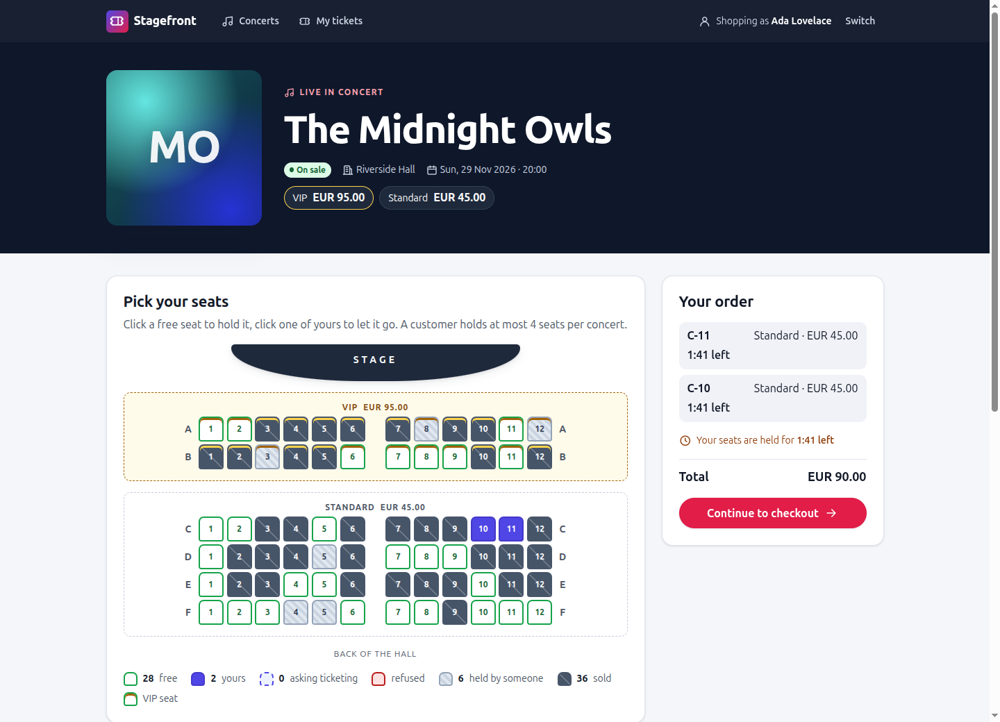
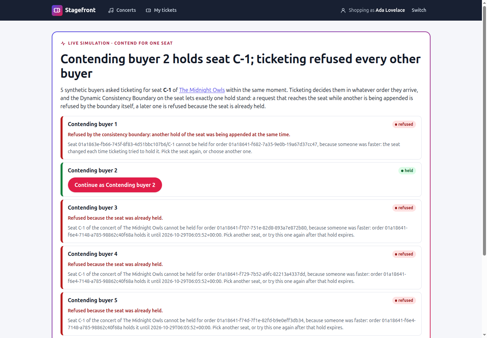
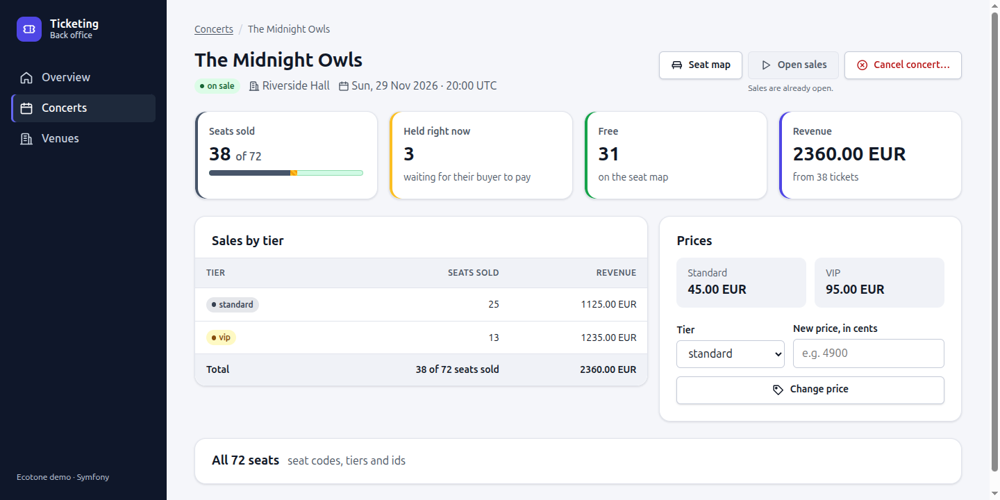
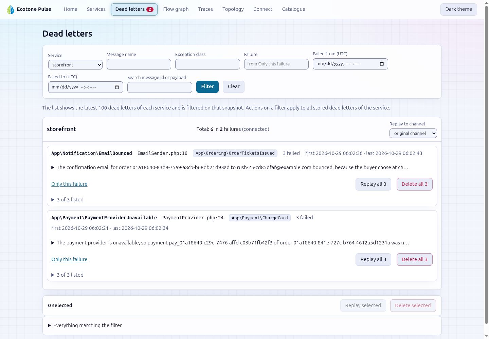

# Ecotone demo

Two services selling concert seats to each other over the Ecotone Distributed Bus on RabbitMQ, traced into Jaeger and
operated from Ecotone Pulse:

- **ticketing**, a Symfony 8 service (`demo/ticketing`): the catalogue, the seats under a Dynamic Consistency Boundary,
  and ticket issuance
- **storefront**, a Laravel 12 application (`demo/storefront`): customers, orders, the checkout, and a rush of synthetic
  buyers

Both resolve `ecotone/*` from this repository's `packages/`, so they run the Ecotone you are working on.

## Run it

You need Docker. From the repository root:

```bash
docker compose -f demo/docker-compose.yml up -d --build --wait
```

The first start builds one PHP 8.5 image and installs each application's `vendor/` into the checkout, so give it a few
minutes; `--wait` returns once every container is healthy (`docker compose -f demo/docker-compose.yml ps` shows the
same). Each start migrates the databases and seeds the demo data, so there is nothing else to run. Check that the two
services hear each other:

```bash
docker compose -f demo/docker-compose.yml exec storefront php artisan demo:ping
```

It prints `Reply arrived: pong from ticketing to storefront` once ticketing's reply reaches the storefront. Stop the demo
with `docker compose -f demo/docker-compose.yml down`, and add `-v` to drop the Postgres and RabbitMQ volumes as well.

After pulling a change to the messages the two services exchange or store, or to how ticketing indexes them, start
from empty volumes and a fresh ticketing cache, because the stored events and the queued messages still have the old
shape. Events stored while `concert` was a filter-only tag carry no position in it, so the seat map and sales ledger,
partitioned per concert, cannot resume past them. Seats held or sold before ticketing announced `tickets.seat_held`,
`tickets.seat_released` and `tickets.seat_sold` were never announced, so on an older stack the storefront's seat picker
shows them free until the volumes are dropped and the seed sells its seats again:

```bash
docker compose -f demo/docker-compose.yml down -v
rm -rf demo/ticketing/var/cache/dev
docker compose -f demo/docker-compose.yml up -d --build --wait
```

Ticketing's development cache keeps each event's serialization metadata and does not notice when an event gains a
field. The `ticketing` container deletes that metadata on each start, and the `rm` clears the rest of the cache, which
would otherwise fail a fresh database with "Typed property ... must not be accessed before initialization". A
`tickets.*` reply queued for the storefront before the change fails there with "Undefined array key" until the
volumes are dropped.

## What it looks like

The storefront's hall during a rush: free seats, seats held by someone and sold seats greyed out, two seats held by
you, and the order panel with the countdown and the total.



A contention of five buyers for one free seat: the Dynamic Consistency Boundary lets one hold stand and refuses the
other four, each with its reason.



A concert in ticketing's back office: seats sold, held and free, revenue, sales by tier, and the actions on the
concert.



Pulse's dead letters after a rush, grouped by exception, `EmailBounced` and `PaymentProviderUnavailable`, each with
Replay and Delete.



The rest are in [`docs/screenshots`](docs/screenshots).

## Open it

| What | URL |
|---|---|
| Storefront | http://localhost:8000 |
| Ticketing (admin, seat maps, ticket pages) | http://localhost:8001 |
| Ecotone Pulse | http://localhost:8080 |
| Jaeger | http://localhost:16686 |
| RabbitMQ management (guest / guest) | http://localhost:15672 |

## Buy a seat

1. On the storefront, open **Who am I** (`/whoami`) and pick a customer. There is no login; the demo customers are
   registered when the storefront starts.
2. Open **Concerts** and a concert on sale, The Midnight Owls for example. The hall shows every seat ticketing holds
   for someone else or has sold greyed out and disabled, striped for held and dark for sold, with the counts in the
   legend; Neon Harbour shows the seed's sales that way before anyone clicks. Click a free seat. The seat turns
   "asking ticketing" while the storefront sends `tickets.hold` over the Distributed Bus, then yours, with a countdown
   to the hold's expiry: ticketing holds a seat for 120 seconds in the demo (`TICKETING_HOLD_SECONDS`). Click it again
   to let it go. The order panel beside the hall lists your seats with their prices, the countdown and the total, and
   **Continue to checkout** appears once every seat you asked for is held.
3. At checkout, the **Demo controls** box, set apart from the payment form, chooses how the payment stub answers: **the payment succeeds** (the default), **the card is declined**
   (the order fails and its seats are released) or **the payment provider is down** (the charge lands in the dead
   letters until you replay it from Pulse, below), and whether **the confirmation email bounces** (unticked by default).
   With the payment succeeding, the charge runs on `storefront_async`, the
   paid order sends `tickets.confirm`, ticketing sells the seats and issues the tickets, and the order page shows them
   with their entry codes a few seconds later. The confirmation email goes through the storefront's email stub, which
   records it in its `sent_emails` table instead of sending it.
4. Open a ticket in ticketing at `http://localhost:8001/tickets/<ticketNumber>`: the page a door scanner would read,
   laid out as a ticket with the seat and the tier, a VIP lounge pass band on a VIP seat, and the entry code on its
   stub. It prints as the ticket alone.

Ticketing is the promoter's back office. `/admin` lists the concerts with their sale state and how many seats are sold,
held and free; a concert's page shows those counts, its revenue and its sales by tier, and is where you open its sales,
change its prices and cancel it (behind a confirmation). Each concert has a public seat map
(`/concerts/{concertId}/seats`), outside the back office and linked from every ticket, drawn as the hall: the stage, the VIP and standard rows, and every seat marked free, held or sold, with a legend that
counts them. The seat map and the sales ledger are projections. No page needs JavaScript; the seat map reloads itself
every three seconds.

## Run a rush

A concert's page on the storefront has a **Simulate a rush** panel: it sends a crowd of synthetic buyers after the seats
while you pick yours. Start one with the defaults (30 buyers: 30% whose card is declined, 10% hitting a payment provider
outage, 10% whose confirmation email bounces), or from the console:

```bash
docker compose -f demo/docker-compose.yml exec storefront php artisan demo:rush <concertId> --buyers=20
```

The status line under the panel counts the buyers as they hold, pay, get their tickets, fail or give up. Then watch:

- **The seat map** on the storefront's concert page greys out the seats the crowd holds and buys as ticketing announces
  them, so the free seats left shrink under your cursor; ticketing's seat map stripes them amber as held and darkens
  them once sold.
- **Pulse → Dead letters** groups the failed messages by exception: `PaymentProviderUnavailable` for the outage share
  and `EmailBounced` for the bounce share once their tickets are issued. Each one can be replayed or deleted, one at a
  time or the whole group. A replayed `EmailBounced` bounces again, since the bounce was chosen for the order: the
  buyer's tickets and entry codes are on their order page (`/orders/{orderId}`, the account page links it), so the
  operator hands them over from there and then deletes the dead letter.
- **Pulse → Traces** lists the flows of both services; open one to see every handler it went through, across the
  Distributed Bus.
- **Pulse → Services → ticketing → Projections** shows the seat map and the sales ledger with their positions, and
  **Rebuild** and **Backfill** for each.
- **Pulse → Flow** draws the graph of the messages each service handles and sends. The storefront sends its
  `tickets.*` commands through one helper with the routing key in a variable, which static inference cannot see, so
  the graph draws no storefront → ticketing command arrows.
- **Jaeger**: a trace follows a flow across both services, because the Distributed Bus carries its context. In a
  hold, `process SeatSalesOverDistributedBus::hold` decides in `Decision Models: App\Sales\SeatSales::hold` and appends
  in `Conditional Append: ecotone_event_stream`: that is the Dynamic Consistency Boundary. A conflict shows as that
  append span marked as an error: a hold arriving over the Distributed Bus is refused at once with "someone was
  faster", while a send through the command bus, such as an expiry, retries it up to three times, one `Decision
  Models` span per attempt. A payment's trace (`process Checkout::pay` in `storefront`) runs on into ticketing's
  confirm and the issuance orchestrator: `TicketIssuance::allocateNumbers` and `grantVipLoungePasses`, then a
  `receive ticketing_async` hop into `renderTickets` and `registerEntryCodes`, another into `announceIssuedTickets`, and back to the
  storefront's `TicketingReplies::whenTicketsIssued` and `Order::markTicketsIssued`. A whole rush is one trace, from `RushSimulator::start` through every tick.

## Contend for one seat

The **Contend for one seat** panel on a concert's page shows the Dynamic Consistency Boundary on a single seat. Pick a
free seat (the list marks the seats ticketing holds or sold and does not offer them; a contention for one is refused
before any buyer asks, naming the seat) and a number of buyers (2 to 10, 5 by default), then press **Contend for this seat with
5 buyers**. The storefront creates that many synthetic buyers. Each starts an order and asks ticketing for the same
seat, each with its own hold id, within the same moment. Ticketing decides them in whatever order they arrive, and the
Dynamic Consistency Boundary on the seat lets exactly one hold stand: a request that reaches the seat while another is
being appended is refused by the boundary itself, a later one is refused because the seat is already held. The
contention page (`/contentions/{contentionId}`) polls their state every second. On a free seat one buyer turns green
(held) and every other one turns red (refused), and each refusal says which of the two it was above the reason
ticketing replied with: a request refused by the boundary is told the seat changed each time ticketing tried to hold
it, one that read the seat already held is told who holds it and until when. The headline says how the contention
ended: which buyer holds the seat, or, when the seat changed hands before the requests arrived, that no buyer got it,
with ticketing's reason. A seat the storefront already knows as held or sold is not offered for a contention at all.

The winner's order is a normal held order: **Continue as** that buyer to pay for it, or let the hold expire. Every
refused buyer's order fails with ticketing's reason. In Jaeger, the contention is one trace across both services, with
one `SeatSalesOverDistributedBus::hold` per buyer. A request that read the seat already held ends in its `process
SeatSales::hold` marked as an error; one refused by the boundary ends in a `Conditional Append: ecotone_event_stream`
marked as an error.

## Replay a dead-lettered payment

A buyer of the outage share, or you choosing **the payment provider is down** at checkout, hits the outage on the first attempt,
so the charge lands in the dead letters and the order stays paying. Open **Pulse → Dead letters**, expand
`PaymentProviderUnavailable` and press **Replay all** (or tick one message and **Replay selected**): the charge runs
again, succeeds this time, and the order completes: paid, confirmed by ticketing, tickets issued. Replay it while the
seats are still held, within the two minutes of their countdown; after that ticketing refuses the confirm because the
holds expired, and the order fails with its refund queued. From the console the same is `php artisan
ecotone:deadletter:replay <messageId>` in the storefront container.

## Force a render failure and replay it

Make the render of one seat's ticket fail on the ticketing worker, then buy that seat (C-7 here):

```bash
TICKETING_RENDER_FAILS_FOR_SEAT=C-7 docker compose -f demo/docker-compose.yml up -d ticketing-worker
```

The order is paid and confirmed, but its issuance stops at `ticket.render`: the routing slip lands in Pulse's dead
letters with a `TicketRenderFailure` that names the way out. Recreate the worker without the variable (a restart keeps
the old environment), then replay the message from Pulse or with `bin/console ecotone:deadletter:replay <messageId>` in
the ticketing container:

```bash
docker compose -f demo/docker-compose.yml up -d ticketing-worker
```

The slip resumes at the render with the ticket numbers it already allocated, and the tickets reach the storefront.

## The stubs

The storefront talks to no real payment provider or mail server. The checkout asks which answer each stub gives:

| Input | What happens |
|---|---|
| **The payment succeeds** (the default at checkout) | The card is charged and the order goes on to its tickets |
| **The card is declined** | The charge is declined and the order fails, releasing its seats |
| **The payment provider is down** | The provider is unavailable on the first attempt: the charge is dead-lettered until you replay it, then succeeds |
| **The confirmation email bounces** (unticked by default) | The confirmation email bounces and always lands in the dead letters; the entry codes stay on the order page |

## Where each Ecotone feature lives

| Feature | What it does here | Code |
|---|---|---|
| Doctrine ORM aggregates | Venues and concerts, with command handlers on the entities | `ticketing/src/Catalogue/Venue.php`, `Concert.php` |
| Eloquent aggregates | Customers and orders as Eloquent models; an order is saved under optimistic locking on its `#[Version]`, so two writers that loaded it cannot overwrite each other: the one that saves second is retried against the order as the first left it, on the command bus (two clicks at once) as on the asynchronous endpoints | `storefront/app/Customer/Customer.php`, `storefront/app/Ordering/Order.php`, `OrderRepository.php` |
| Dynamic Consistency Boundary | Holds, releases, expiries and sales decided on the `SeatAvailability` and `CustomerConcertSeats` decision models, scoped by the `seat` and `customerConcert` tags of their events; a confirm adds the `seat` tags of its seats through a `#[DecisionBoundary]` | `ticketing/src/Sales/SeatSales.php`, `SeatAvailability.php`, `CustomerConcertSeats.php`, `SeatHeld.php` |
| Outbox | Ticketing's announcements go out from `ticketing_async`, a Doctrine Messenger transport committed with the change; the storefront's requests to ticketing, charges and emails go out from `storefront_async`, a database queue committed with the order | `ticketing/src/Catalogue/ConcertAnnouncements.php`, `storefront/app/Ordering/TicketingRequests.php` |
| Distributed Bus with replies | `tickets.hold` and `tickets.confirm` sent to ticketing and answered with `tickets.hold.result` and `tickets.confirm.result`; events such as `tickets.issued` published to the storefront | `ticketing/src/Sales/SeatSalesOverDistributedBus.php`, `storefront/app/Ordering/TicketingRequests.php`, `TicketingReplies.php` |
| Delayed messages | A hold expires through a message delayed until its expiry, which frees only the hold it was scheduled for | `ticketing/src/Sales/HoldExpiry.php` |
| Projections | The seat map and the sales ledger of each concert, on `ticketing_async` | `ticketing/src/Sales/ConcertSeatMap.php`, `ConcertSalesLedger.php` |
| Orchestrator | Ticket issuance as a routing slip built from the order, with an asynchronous hop before the render | `ticketing/src/Issuance/TicketIssuance.php` |
| Flow tracking and Pulse | Each service records its flows and answers Pulse over the Distributed Bus | both apps' `Infrastructure/EcotoneConfiguration.php`, Pulse in `apps/Pulse` |
| OpenTelemetry | Every handler, bus and channel traced to Jaeger over OTLP | both apps' `Infrastructure/EcotoneConfiguration.php` and `OtlpTracerProviderFactory.php` |
| Dead letters and retries | Failures dead-lettered to the database and replayed from Pulse or the console; the storefront retries transient database errors and an order saved by another writer first on the spot, ticketing retries a DCB conflict on a command-bus send three times | both apps' `Infrastructure/EcotoneConfiguration.php` |

## How it works

### Catalogue

Ticketing owns the catalogue: venues and concerts are Doctrine ORM aggregates, managed at `/admin` on the ticketing
URL. Every start of the web container runs `bin/console demo:seed`, which creates Riverside Hall (rows A to F of 12
seats, rows A and B VIP) and three concerts once. Scheduling a concert, opening its sales and cancelling it is
announced to the storefront as `concert.scheduled`, `concert.sales_opened`, `concert.prices_changed`, `concert.sold_out` and
`concert.cancelled`: an event handler on
`ticketing_async` publishes each over the Distributed Bus after the command's transaction commits.

### Seat sales

Ticketing holds, releases, expires and sells the seats of a concert on sale under a Dynamic Consistency Boundary:
`SeatHeld`, `HoldReleased`, `HoldExpired` and `SeatSold` are tagged `concert`, `seat` and `customerConcert` and
appended to `ecotone_event_stream` by handlers that decide on two decision models, `SeatAvailability` (one live hold
per seat) and `CustomerConcertSeats` (at most 4 seats per customer and concert). The customer limit is scoped by one
`customerConcert` tag rather than by `customer` and `concert` together, because a model scoped by `concert` would make
every hold of a concert conflict with every other; `concert` stays on each event, captured by no model, as the
projections' key: an append only increments its counter, so overlapping holds of one concert do not conflict on it.
A hold and a confirm fetch the `Concert` read-only with `#[Fetch]`: holds of different seats of one concert never conflict
on the concert, while a cancellation or price change saved between their read and their append makes them conflict, and the
retry decides again on the concert as it now is; a hold that lands before a cancellation is released by it. A conflict on a command-bus send is retried three times, and an exhausted one is refused with "someone
was faster"; a `tickets.hold` or `tickets.confirm` arriving over the Distributed Bus is not retried, so a conflict
there is refused at once with that reason, or, when the concert changed, with a reason naming the concert's change:
a refused hold is held again at the current prices on the buyer's next click, a refused confirm sells nothing and is
refunded. Every hold carries the `holdId` its requester chose, and only the order,
customer, concert and hold id of a hold release it, so a late release of an earlier hold leaves a later one in place.
A hold expires after `TICKETING_HOLD_SECONDS` (600 by default, 120 in `docker-compose.yml`), through a delayed message
on `ticketing_async` that frees only the hold it was scheduled for. A confirm decides on the customer's holds and,
through a `#[DecisionBoundary]` over the `seat` tag of every seat it sells, on the seats themselves: another customer's
hold of a seat whose hold just expired, appended while the confirm decides, makes the confirm's append conflict, so a
seat is sold once: the storefront's `tickets.confirm` is refused at once with "someone was faster", and the storefront
fails the order and refunds it (a command-bus send would retry and refuse naming the order that holds the seat). A
confirm repeated for an order already sold with the same payment reference replies `sold` again and sells nothing
twice, also when the two copies are handled at once by two consumers, with one window left: a copy that commits
between the other copy's fresh read of the seat and its append is still refused over the Distributed Bus, because a
send nested in the consumer's transaction is not retried, and the storefront then fails and refunds that order. The storefront drives it
with `tickets.hold`, `tickets.release` and `tickets.confirm` over the Distributed Bus, and gets `tickets.hold.result`
and `tickets.confirm.result` replies; a held reply for a hold id the order no longer awaits releases that hold, and a
`tickets.hold_expired` drops a seat only when it names the order's current hold. Each concert has a seat map at
`/concerts/{concertId}/seats` on the ticketing URL, linked from its admin page next to its sales ledger; both are
projections on `ticketing_async`. `demo:seed` sells all but the last three seats of Neon Harbour, and selling those
marks it sold out (`concert.sold_out`); `demo:seed --catalogueOnly` seeds the venue and the concerts without that sale.
The seed confirms its orders with `ConfirmSeedOrder`, which records their `SeatSold` events without `SeatsSoldToOrder`:
those orders exist only in ticketing, so they get no tickets and the storefront is never told about them.

### Partitioned seat map and sales ledger

`ConcertSeatMap` and `ConcertSalesLedger` are partitioned per concert with `#[FromTaggedStream('concert')]` and
`#[Partitioned]`: each concert's partition reads only the seat events tagged with its id, in the order of that tag,
and keeps its own position, so a busy concert never holds back another. A rebuild or backfill, from the console or from
Pulse, which lists both projections as partitioned, resets and replays one concert at a time: the `#[ProjectionReset]`
takes the concert's id through `#[PartitionTagValue]` and deletes only that concert's rows.

### Ticket issuance

A confirm that sells an order's seats records one `SeatsSoldToOrder` event beside the order's `SeatSold` events, so
issuance starts once per order rather than once per seat: an event handler on `ticketing_async` sends `IssueTickets`
with the `concertId` header to the `TicketIssuance` orchestrator, so the start survives a worker restart. The
orchestrator builds its routing slip from the order: `ticket.allocate_numbers`, then `ticket.vip_lounge_pass` only when
the order holds a VIP seat, then `ticket.render` on `ticketing_async`, which writes `var/tickets/<ticketNumber>.txt`,
then `ticket.register_entry_codes` into the `issued_tickets` table, and `ticket.announce` on `ticketing_async` again,
which publishes `tickets.issued` to the storefront. The announce is queued in the same transaction as the
registration, so a registration that rolls back announces nothing, and its replay announces the tickets it registered.
Ticket numbers are UUIDs and entry codes are random, both generated once per order, so issuing an issued order again
announces the same tickets. The announce itself is effectively once rather than exactly once: a worker that dies
between the publish to RabbitMQ and its own commit announces the same tickets again on the retry, and the storefront
treats an identical set as already applied. Each ticket has a page at `/tickets/{ticketNumber}` on the ticketing URL,
read through `ticket.detail`. In Jaeger, the trace of a confirm shows the allocate and VIP steps, then, after a
`receive ticketing_async` hop, the render and register steps, and after a second hop the announce step. `TICKETING_RENDER_FAILS_FOR_SEAT` on `ticketing-worker` makes the render of one
seat fail, see [Force a render failure and replay it](#force-a-render-failure-and-replay-it).

### Customers and orders

The storefront keeps customers and their orders as Eloquent aggregates, and a concert list fed by ticketing's
`concert.scheduled`, `concert.sales_opened`, `concert.prices_changed`, `concert.sold_out` and `concert.cancelled` events. There is no login: the storefront registers the demo
customers when it starts (`php artisan demo:seed`, safe to repeat), you pick one on `/whoami`, and browse `/concerts`
and your orders on `/account`.

### Seat availability

Ticketing announces every change of a seat to the storefront: `tickets.seat_held` {concertId, seatId, orderId, holdId,
expiresAt} from `SeatHeld`, `tickets.seat_released` {concertId, seatId, orderId, holdId} from `HoldReleased` (a release, or a
cancellation releasing the concert's holds) and from `HoldExpired`, and `tickets.seat_sold` {concertId, seatId, orderId}
from `SeatSold`, for the storefront's confirms and the seed's alike. `SeatStateAnnouncements` publishes them from
`ticketing_async`, queued in the transaction of the decision, like the concert announcements. Two ticketing workers
publish them, so they can arrive in any order; the storefront's `SeatStateProjector` decides by hold id and by state
precedence rather than by arrival: a hold id names one hold, a release ends it whether it arrives before or after the
hold, so a late `tickets.seat_held` never revives a released hold, and a sold seat stays sold whatever arrives after
it. A hold also ends at its `expiresAt`, by the storefront's clock, without waiting for a release: ticketing hands a
seat whose hold has expired to the next order before its delayed `ExpireHold` runs, and that expiry then finds the seat
held by someone else and announces nothing, so the release of the first hold never comes. `concert.seat_states` answers the held and sold seats of a concert, leaving out the asking order's own holds and
adding the seats other storefront orders asked for before ticketing announced them; the seat picker, the rush and the
contention read it, so neither the crowd nor a contention asks ticketing for a seat the storefront knows is taken.

### Checkout

Pick a customer on `/whoami`, open a concert that is on sale and click free seats: each click asks ticketing for a hold
with `tickets.hold` over the Distributed Bus, and the page polls `/orders/{orderId}/state.json` every second to mark the
seat yours (with a countdown to the hold's expiry), held by someone, or refused with ticketing's reason. Click one of
yours to release it. Every request to ticketing (`tickets.hold`, `tickets.release`, `tickets.confirm`) and every refund
is queued on `storefront_async`, the database queue in the same transaction as the order change behind it, so it leaves
only when that change commits. The `storefront-worker` container sends it within a fraction of a second, so a hold still
shows on the page's next poll; with the worker stopped, clicks wait in the queue. The checkout charges the card on
`storefront_async` through a payment stub whose answer the buyer chooses on the checkout form: the payment succeeds, the
card is declined and the order fails, or the provider is down on the first attempt, so the charge lands in the dead letters until you replay it (`php artisan
ecotone:deadletter:replay <messageId>` in the storefront). Only transient database errors and an order another writer
saved first are retried on the spot, so a provider outage reaches the dead letters instead of being retried away, and a
payment reference is charged once however often its charge runs. A paid order sends `tickets.confirm`; `tickets.issued`
shows the tickets with their entry codes on the order page and emails them, and an email the buyer chose to bounce at
checkout always lands in the dead letters. Replaying it cannot deliver it; the entry codes stay on the buyer's
order page, which is where the customer gets them, and the dead letter is deleted once they have.

### The rush

The page of a concert on sale, and the page of an order for it, has a "Simulate a rush" panel: it sends a crowd of
synthetic buyers after the seats while you pick yours (the same from the console: `docker compose -f
demo/docker-compose.yml exec storefront php artisan demo:rush <concertId> --buyers=30 --declinedShare=30
--outageShare=10 --bounceShare=10 --seatsPerBuyer=2`). The whole rush is one `AdvanceRush` message on
`storefront_async`, sent again every 2 seconds (every 5 while every buyer waits on ticketing): each tick lets 20 more
buyers join and moves up to 10 buyers one step, the buyers that first asked ticketing earliest before the ones yet to
ask, so the crowd's holds and charges never queue far ahead of yours. A buyer starts an order and asks ticketing for
free seats one at a time, exactly as the seat picker does, tries another seat when one is refused (three refusals and it
gives up), and pays once its seats are held: the declined share choosing a declined card, the outage share choosing the
provider outage, the bounce share choosing that its confirmation email bounces. A buyer whose seats are not held 120 seconds after it
asked ticketing for the first one gives up and fails its order (`RUSH_BUYER_DEADLINE_SECONDS`), and a rush lets every
buyer still picking go 600 seconds after it started (`RUSH_DEADLINE_SECONDS`), so a rush ends on its own even when
ticketing never answers. The status line under the panel polls `/rushes/{rushId}/state.json` every second, stops
once every buyer has had a go, and counts the buyers created and then each buyer once, at the stage its order is at
now: held (seats held, not yet paying), paying, paid, issued (tickets issued), failed (declined or refused by ticketing)
and gave up. [Run a rush](#run-a-rush) lists what to watch while it runs.

A rush is safe to replay from the dead letters; a tick handled twice is skipped, and a buyer that already joined is not
created twice. A tick in the dead letters pauses its rush until it is replayed.

### The contention

`POST /concerts/{concertId}/contentions` sends one `StartContention` through the command bus. Its handler registers
the buyers, starts their orders, and sends one `RequestSeat` per buyer with a fresh hold id. The hold requests queue on
`storefront_async` like any seat request, one message per buyer, and reach ticketing over the Distributed Bus as fast as
the two `storefront-worker` replicas send them, while both `ticketing-worker` replicas decide them in parallel. Measured
on a local stack, a run had one conflicting append in 11 of 12 runs of 5 buyers and 8 of 11 runs of 10 buyers with one
`storefront-worker`, and in 10 of 12 and 12 of 12 with two, never more than one: two ticketing workers let at most two
requests read the free seat together, and once one hold is appended every later request reads the seat held. An order records
`SeatRefused` when ticketing refuses its hold, and the contention fails a contending buyer's order on it with ticketing's
reason. Orders of real customers are left open, so their owners can pick another seat. `/contentions/{contentionId}/state.json`
derives each buyer's state from its order: pending while its hold request is unanswered, held, refused with the reason,
or released once the winner's hold has ended.

Rush and contention buyers are synthetic customers: they are not listed on `/whoami`, so their account pages are not
browsable, except that a contention offers to continue as its winner.

## Ports and parallel stacks

Every host port is an environment variable, and so is the stack's name:

```bash
COMPOSE_PROJECT_NAME=demo-two DEMO_STOREFRONT_PORT=9000 DEMO_TICKETING_PORT=9001 DEMO_PULSE_PORT=9080 \
DEMO_JAEGER_PORT=26686 DEMO_RABBITMQ_MANAGEMENT_PORT=25672 docker compose -f demo/docker-compose.yml up -d --build
```

The containers run as uid and gid 1000 so that `vendor/` stays owned by you; set `DEMO_UID` and `DEMO_GID` when your
user has other ids. The top of `docker-compose.yml` documents every variable.

## Licence

Distributed Bus, Pulse and flow tracking are Ecotone Enterprise features. Without a key the demo runs on Ecotone's
testing licence, and each container says so when it starts. To run on your own key:

```bash
ECOTONE_LICENCE_KEY=<your key> docker compose -f demo/docker-compose.yml up -d
```

## Working on Ecotone with the demo

Each application installs `ecotone/*` through a symlinked Composer path repository onto `../../packages/*`, with every
package pinned to `2.0.x-dev` in a generated `composer.pinned.json`. An edit under `packages/` is therefore live in the
web containers on the next request, without a rebuild. The workers are long-running `ecotone:run` processes: restart
them to load the edit (`docker compose -f demo/docker-compose.yml restart ticketing-worker storefront-worker`).

When a container starts and finds its application's `composer.json` newer than `vendor/autoload.php`, it updates the
application's dependencies, so recreate the containers after editing it (`docker compose -f demo/docker-compose.yml up
-d --force-recreate storefront storefront-worker`). A change to a package's `composer.json` under `packages/` needs a
fresh install: delete the application's `vendor/` and restart its containers.

Pulse runs from your own `apps/Pulse` checkout, so the demo shares its `vendor/` and `var/` with the Pulse you develop
on the host. A `vendor/` you installed there differently, for example with `--copy` or other package versions, is the
one the demo runs, and each start of the `pulse` container clears `apps/Pulse/var/cache` on the host.

## Tests

Inside the containers, one application at a time:

```bash
docker compose -f demo/docker-compose.yml exec ticketing composer tests:ci
docker compose -f demo/docker-compose.yml exec storefront composer tests:ci
```

The tests use the `ticketing_test` and `storefront_test` databases of the demo's Postgres.

`demo/docker/smoke.sh` runs what CI's compose smoke job runs, from the repository root: it starts the stack, waits until
both services are Connected in Pulse, runs `demo:rush` with 20 buyers on The Midnight Owls, and checks that an order got
its tickets, that Pulse lists a dead letter and that Jaeger holds a trace spanning both services. It takes the stack down
with its volumes when it ends (`SMOKE_KEEP_STACK=1` keeps it), and honours `COMPOSE_PROJECT_NAME` and the port variables.
