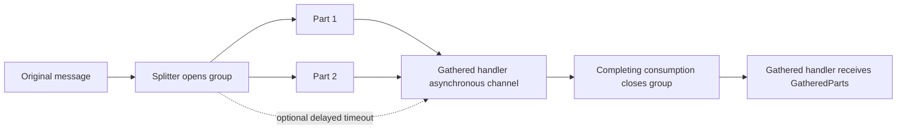

# Split, work, gather

Message gathering is an Ecotone Enterprise feature. An existing splitter opts in by naming a gather channel;
ordinary splitters keep their existing behaviour. The target is an ordinary `#[InternalHandler]` or
`#[CommandHandler]` stacked with `#[Gathered]` and `#[Asynchronous]`.

```php
use Ecotone\Api\Attribute\Asynchronous;
use Ecotone\Api\Attribute\Gathered;
use Ecotone\Api\Attribute\InternalHandler;
use Ecotone\Api\Attribute\Splitter;
use Ecotone\Api\Messaging\GatheredParts;
use Ecotone\Api\Scheduling\TimeSpan;

#[Splitter('import.split', endpointId: 'import.splitter', outputChannelName: 'import.work', gatherChannelName: 'import.summary')]
public function split(array $parts): array
{
    return $parts;
}

#[Asynchronous('import_workers')]
#[InternalHandler('import.work', endpointId: 'import.worker')]
public function work(int $part): int
{
    return $part * 2;
}

#[Gathered(timeout: new TimeSpan(minutes: 30))]
#[Asynchronous('import_summaries')]
#[InternalHandler('import.summary', endpointId: 'import.summary', outputChannelName: 'import.results')]
public function summarize(GatheredParts $parts): array
{
    return $parts->results;
}
```

These methods belong to your application handler. Route the original request to `import.split` through your
existing handler, configure both asynchronous channels, and handle the final result on `import.results`.
The gathered handler's consumer must run even when all work happens synchronously or the split is empty.



`GatheredParts` provides:

- `results`: keyed by the original one-based part number, in split order. A completed part returning nothing has
  a `null` value. A missing part has no result entry.
- `missingPartNumbers` and `size`: which work is missing and how many parts were split.
- `originalPayload`: the message payload at the time it was split.
- `releaseReason`: `GatheredReleaseReason::ALL_PARTS_ACCOUNTED_FOR`, `TIMEOUT` or `MANUAL_RELEASE`.

The released message restores application headers and correlation/tracing context. It follows the gathered
handler's output flow. It does not resume the split request's routing slip or answer its synchronous caller.
Sending another command or publishing an event starts a separate flow, without the current group headers.
A nested splitter must name its own gather channel; its gathered result becomes the outer part's result.

## Failure, timeout and storage

Without `timeout`, the group waits for all parts. A failed part remains missing: fix it and replay it from the
dead letter. With a timeout, a delayed message is queued at the split on the gathered handler's asynchronous
channel. That channel must support the requested delay within its broker's limits. The handler receives the
results that have arrived and the missing part numbers when the timeout is consumed.

The last part or release trigger runs the handler in its consumption transaction. If the handler fails, the
last arrival/group closure rolls back and ordinary retries and dead-letter handling apply. Duplicate part
reports do not count twice. An empty split invokes the asynchronous gathered handler with zero parts.

Flow testing without DBAL uses an in-memory store. Bootstrapping without test configuration requires the DBAL
module for gathering, including ordinary `EcotoneLite::bootstrap()` and framework kernels in a test environment.
Install `ecotone/dbal` and enable `ModulePackageList::DBAL_PACKAGE` in EcotoneLite's `enabledModules`, or add
`'dbal'` to `enabledModulePackageNames` in Symfony, Laravel's `config/ecotone.php`, or Tempest's `EcotoneConfig`.
With DBAL, groups and parts survive restarts and are shared between workers. Configure its connection and,
before processing messages, run `ecotone:migration:database:setup --initialize --feature=gathering`, or generate
SQL for your application migrations with `ecotone:migration:database:setup --sql --feature=gathering`.
Gathering never creates tables while handling messages.

Late part reports are acknowledged without invoking a closed group's handler again, and increment its retained
`latePartCount`. Closed groups are retained for seven days from release or discard. Configure another period
through a `#[ServiceContext]` method:

```php
use Ecotone\Api\Attribute\ServiceContext;
use Ecotone\Api\ExtensionObject\GatheringConfiguration;
use Ecotone\Api\Scheduling\TimeSpan;

#[ServiceContext]
public function gathering(): array
{
    return [GatheringConfiguration::createWithDefaults()->withRetention(new TimeSpan(days: 14))];
}
```

Cleanup removes expired closed groups and their parts, and keeps open groups. Replaying a part after its group
has been cleaned up is refused with a message naming this retention setting.

## Operations

Use the `Ecotone\Api\Gateway\GatheredGroups` gateway to `listOpenGroups(gatherChannelName)`,
`listClosedGroups(gatherChannelName)`, `requestRelease(groupId)`, `discard(groupId)` or `cleanupClosedGroups()`.

`requestRelease()` queues a trigger and returns no value. The console and Pulse display `release requested`.
Consume the gathered handler's asynchronous channel to run the handler. A duplicate request or trigger for a
closed group does not run it again. Discard
closes the group without invoking its handler.

The same operations are available through:

```text
ecotone:gathering:list import.summary
ecotone:gathering:list import.summary --closed
ecotone:gathering:release <groupId>
ecotone:gathering:discard <groupId>
ecotone:gathering:cleanup
```

Pulse's Gathering tab shows open and retained closed groups, accounted/missing parts, deadlines and late
arrivals. Open groups offer Request release and Discard. The page reports `Release requested` while the
handler is still waiting for its trigger; a service refusal is shown with its explanation.

Timeouts require an asynchronous channel builder implementing `DelayedMessageChannelBuilder`. Bootstrap refuses
channels without declared delay support and durations exceeding the declared maximum. Standard SQS queues allow
at most 15 minutes; SQS FIFO queues and Kafka cannot hold a per-message timeout. Omit `timeout` to wait for every
part, including successful replay of failed parts. Custom builders can implement the optional public interface;
`maximumDelay()` returns `null` when there is no fixed broker maximum.

For an asynchronous channel chain or `CombinedMessageChannel`, the first physical channel holds the timeout.
Only that first channel needs delay support. A later non-delayable channel is supported after the timeout has
waited until its deadline on the first channel.

Symfony Messenger, Laravel Queue and AMQP channels using a custom delay strategy support delays but cannot
know the underlying transport's maximum. Ecotone trusts an unknown maximum as unbounded and performs no driver
inspection. On these channels, checking and respecting the underlying transport's delay limit is your
responsibility. Channel builders that do not implement `DelayedMessageChannelBuilder` are still refused when
a gathered handler configures a timeout.

Several consumers on the gathered handler's channel can conflict while recording reports for the same group.
Each conflict sends exactly one replacement report with a new message id and returns normally. The replacement
is consumed in a new transaction; it does not re-run the part work, consume the failure retry budget or enter
the dead letter. There is no inline retry loop or backoff. A report can lose only to a committed version-changing
write of its own group, so retries are bounded by group writes (parts, release or discard), rather than consumer
count. One consumer on the gathered handler's channel avoids report-to-report conflicts.

On a transactional DBAL channel using the group store's connection, the replacement commits before the original
is acknowledged. A crash between these steps can leave both deliveries; default message deduplication and the
unique group-id/part-number identity keep completion safe.

## Deployment and connection selection

Upgrade every participating consumer before enabling a gathered flow. Older workers acknowledge parts without
reporting their completion, leaving those groups incomplete.

Gathering storage and table setup use the first connection named by
`DbalConfiguration::withDefaultConnectionReferenceNames([...])`, falling back to the default DBAL connection.
This follows tracing storage's connection selection and includes configured tenant routing. Keep the gathering
tables and report channel on that connection when they must share a message transaction.

A report may arrive before the split's transaction commits when work is published through a non-transactional
channel such as AMQP, SQS or Redis. A consumer cannot see the uncommitted group and refuses that report through
normal retry and dead-letter handling. Publish parts with the split's commit through an outbox / combined channel,
then replay the report. A missing group can also mean its closed-group retention expired; increase retention or
replay before cleanup in that case.
